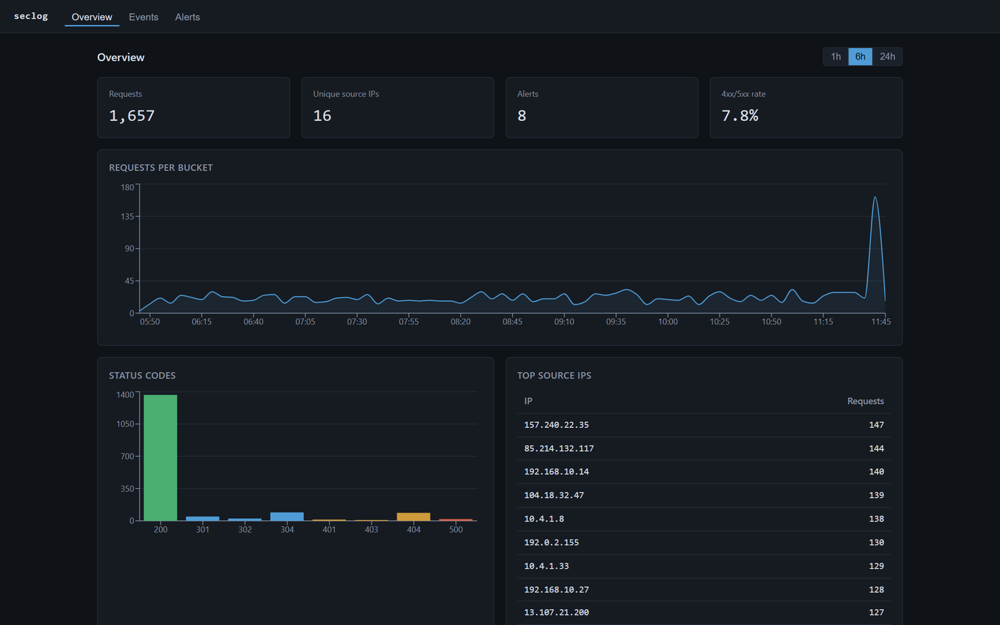

# seclog

Self-hosted dashboard that ingests web access logs, flags suspicious activity, and exposes the data to an LLM through MCP tools.



<!-- Add a screenshot at docs/screenshot.png. -->

## What it does

- Ingests Nginx/Apache combined-format access logs over a batch HTTP endpoint.
- Parses each line into structured fields and stores them in SQLite.
- Runs detection rules in the background and raises alerts: repeated auth failures, request-rate spikes, access to sensitive paths, and scanner user agents.
- Serves a small React dashboard: traffic overview, a filterable event table, and the alert list.
- Ships an MCP server so an agent (Claude Desktop, Cursor, or any MCP client) can query the live data through small, composable tools.

## Quick start

```
docker compose up --build
```

- Dashboard: http://localhost:8088
- API: http://localhost:8080
- MCP (streamable HTTP): http://localhost:8081

The database starts empty. Load demo data, including lines that trip the detection rules (needs Go installed locally):

```
go run scripts/seed.go -url http://localhost:8080
```

## Architecture

```
log sources ─POST /api/ingest─> parser ─> SQLite <─ detection engine ─> alerts
                                            │
                                   REST API (:8080) ─> React UI (nginx :8088)
                                            │
                                   MCP server (:8081 / stdio) ─> LLM client
```

One Go module produces two binaries that share a SQLite file: `server` (REST API plus the detection engine) and `mcp-server` (read-only MCP access). WAL mode lets them run as separate processes against the same database. The frontend is a static React build served by nginx, which proxies `/api` to the backend.

Backend layout:

- `cmd/server` - API server entry point
- `cmd/mcp-server` - MCP server entry point (stdio or streamable HTTP)
- `internal/parser` - combined log format parsing
- `internal/store` - SQLite access layer
- `internal/detect` - detection rules and the background engine
- `internal/api` - HTTP handlers and routes
- `internal/mcp` - MCP tool definitions

## API

| Method | Path | Description |
| --- | --- | --- |
| POST | `/api/ingest` | Ingest a batch of raw log lines. Body: `{"lines": ["..."]}` or `text/plain`, one line per row. |
| GET | `/api/events` | List events. Filters: `ip`, `status`, `path`, `from`, `to`, `limit`, `offset`. |
| GET | `/api/alerts` | List alerts. Filters: `severity`, `rule`, `ip`, `limit`, `offset`. |
| GET | `/api/stats` | Summary stats. Params: `window` (seconds), `bucket` (seconds). |
| GET | `/api/ips/{ip}` | Per-IP summary: counts, status breakdown, top paths, related alerts. |
| GET | `/healthz` | Health check. |

`from` and `to` accept either RFC3339 (`2026-06-08T12:00:00Z`) or Unix seconds.

## Detection rules

The engine wakes on an interval (default 10s), reads events it has not seen yet, evaluates the rules over a recent window, and writes alerts. A rule will not re-raise the same (rule, IP) pair within 10 minutes.

| Rule | Triggers when | Default | Severity |
| --- | --- | --- | --- |
| `auth_failures` | One IP gets many 401/403 responses | 5+ | medium, high at 2x |
| `rate_spike` | One IP exceeds a request rate | 100 / minute | high |
| `suspicious_path` | Requests to sensitive paths (`/.env`, `/.git`, `/admin`, `/wp-login.php`, ...) | any | medium, high for secrets |
| `suspicious_user_agent` | Scanner agents (sqlmap, nikto, nuclei, ...) or empty UA | any | medium, high for offensive tools |

Thresholds are environment variables:

| Variable | Default | Purpose |
| --- | --- | --- |
| `SECLOG_ADDR` | `:8080` | API listen address |
| `SECLOG_DB` | `seclog.db` | SQLite file path |
| `SECLOG_DETECT_INTERVAL` | `10s` | Detection engine tick |
| `SECLOG_AUTHFAIL_LIMIT` | `5` | Auth-failure threshold |
| `SECLOG_RATE_LIMIT` | `100` | Requests per window before a spike |
| `SECLOG_RATE_WINDOW` | `1m` | Rate-spike window |
| `SECLOG_MCP_HTTP` | empty | If set, `mcp-server` serves HTTP on this address |

## MCP server

The MCP server exposes four tools, each a thin wrapper over the store:

- `list_recent_alerts` - recent alerts, optional severity filter
- `query_events` - events by ip, status, path, and time range
- `get_ip_summary` - one IP's activity and related alerts
- `get_stats` - aggregate traffic over a window

### stdio (Claude Desktop, Cursor)

Build the binary and point the same SQLite file the server writes to:

```
go build -o mcp-server ./cmd/mcp-server
```

Add to `claude_desktop_config.json` (Claude Desktop) or your client's MCP config:

```json
{
  "mcpServers": {
    "seclog": {
      "command": "/absolute/path/to/seclog/mcp-server",
      "env": {
        "SECLOG_DB": "/absolute/path/to/seclog/seclog.db"
      }
    }
  }
}
```

### Streamable HTTP

`docker compose up` runs the MCP server over HTTP on port 8081. To run it directly:

```
go run ./cmd/mcp-server -http :8081
```

Point an HTTP-capable MCP client at `http://localhost:8081`.

## Local development

Backend:

```
go run ./cmd/server
```

Frontend (Vite dev server proxies `/api` to `:8080`):

```
cd frontend
npm install
npm run dev
```

Seed data into the running backend:

```
go run scripts/seed.go
```

Tests and vet:

```
go vet ./...
go test ./...
```

## Roadmap

- GeoIP and ASN enrichment for source IPs
- Configurable rules loaded from a file instead of env vars
- Alert acknowledgement and notes
- Support for JSON access-log formats
- Retention/rollup for old events
